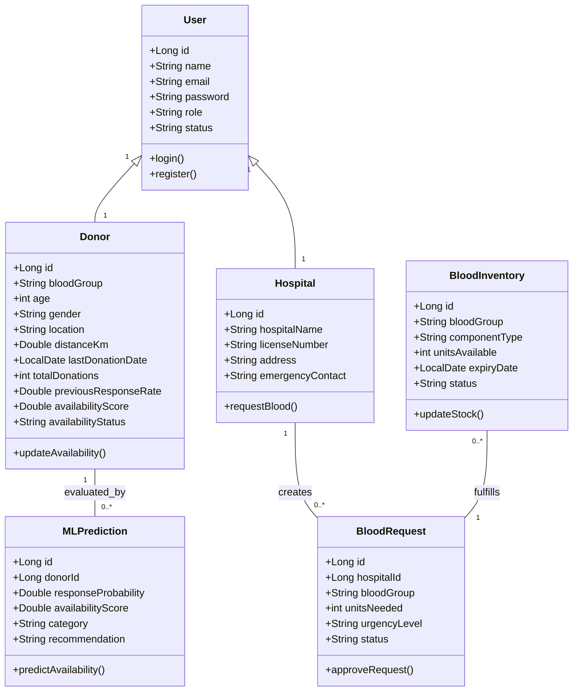
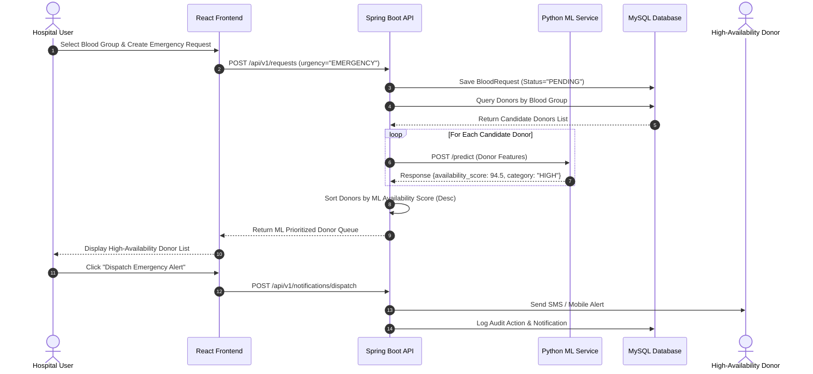
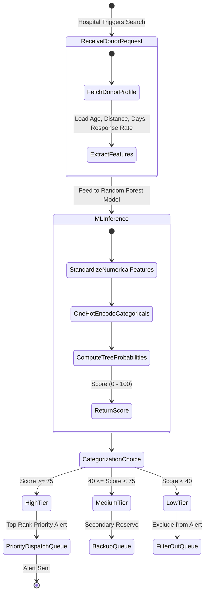

# UML System Architecture Diagrams

This document contains standard UML diagrams for the **Online Blood Bank Management System with Donor Availability Prediction using Machine Learning**.

---

## 1. USE CASE DIAGRAM

```mermaid
graph TD
    subgraph Users ["System Actors & Roles"]
        Admin(("System Admin"))
        Donor(("Donor"))
        Hospital(("Hospital / Doctor"))
        Staff(("Blood Bank Staff"))
    end

    subgraph System ["Blood Bank Management System"]
        UC1["Register & Authenticate (JWT)"]
        UC2["Manage Users & System Roles"]
        UC3["View Analytics Dashboard"]
        UC4["Search Blood Stock Inventory"]
        UC5["Create Emergency Blood Request"]
        UC6["Run ML Availability Prediction"]
        UC7["Schedule Donation Appointment"]
        UC8["Verify & Update Blood Stock"]
        UC9["Dispatch Emergency Donor Alert"]
        UC10["Generate PDF Reports"]
    end

    Admin --> UC1
    Admin --> UC2
    Admin --> UC3
    Admin --> UC6
    Admin --> UC10

    Hospital --> UC1
    Hospital --> UC4
    Hospital --> UC5
    Hospital --> UC9

    Donor --> UC1
    Donor --> UC6
    Donor --> UC7

    Staff --> UC1
    Staff --> UC4
    Staff --> UC8
    Staff --> UC7

    UC5 ..> UC6 : "<<include>>"
    UC6 ..> UC9 : "<<extend>>"
```

---

## 2. CLASS DIAGRAM



---

## 3. SEQUENCE DIAGRAM (Emergency Blood Request & ML Donor Dispatch Workflow)



---

## 4. ACTIVITY DIAGRAM (Donor Availability Prediction & Classification)


